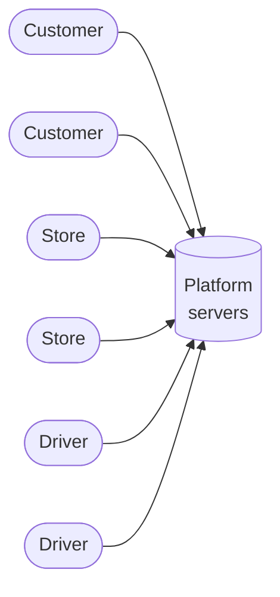
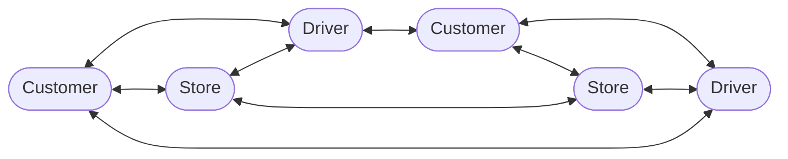
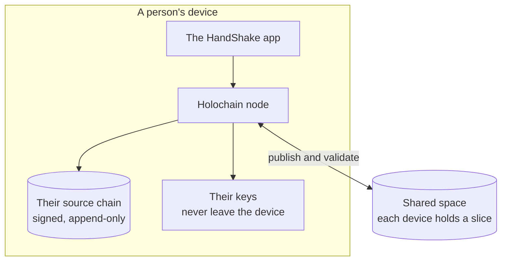
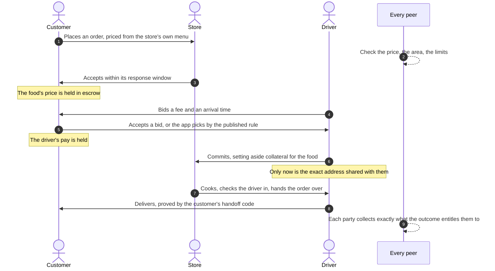
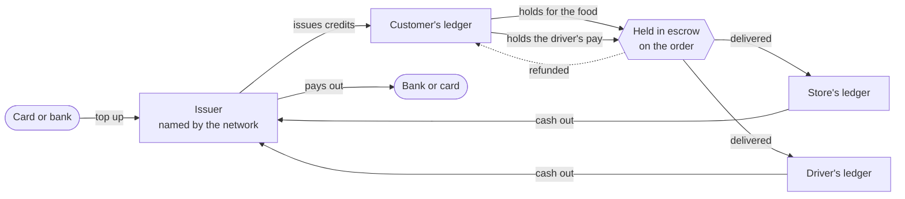
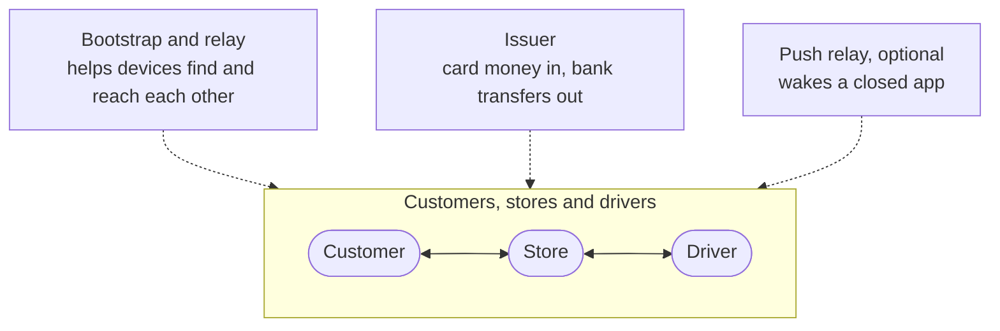

<div align="center">


# HandShake

**Local delivery with no company in the middle.**

Customers order from the stores around them. Drivers bid to carry the orders.<br>
Every rule is checked by everyone, and nobody takes a cut.

Built on [Holochain](https://www.holochain.org)

<br>

[How it works](#how-it-works) &nbsp;&middot;&nbsp; [Why Holochain](#why-holochain) &nbsp;&middot;&nbsp; [An order, step by step](#an-order-step-by-step) &nbsp;&middot;&nbsp; [Money](#money) &nbsp;&middot;&nbsp; [Getting started](#getting-started) &nbsp;&middot;&nbsp; [Docs](#docs)

</div>

<br>

## The idea

A delivery platform today sits between three groups of people who could deal with each other directly. It holds the menu, the order, the address and the money, sets the rules, and takes a share of every order from the store, the driver and the customer.

HandShake removes the middle. Each customer, store and driver runs the app on their own device, and the app *is* the network: there is no application server, no company database and no account anyone can freeze. What the platform used to guarantee, that prices are honest, money is held until the food arrives, and nobody can rewrite what happened, is guaranteed instead by rules that every participant's app checks on everything it stores.

The name is the transaction itself: two people agreeing, peer to peer, with nobody standing between them.

<br>

## How it works

On a platform, every request goes to one company's servers, which decide what is true.



On HandShake, every device is a full participant. Each keeps its own signed history, shares what others need to see, and checks what others share with it.



Three ideas make this work.

**1. Everyone keeps their own history.** Every action a person takes, placing an order, accepting it, bidding, handing food over, is a record on their own *source chain*: an append-only log on their device, each entry signed by their key and linked to the one before. Nobody can write to someone else's chain, and nobody can quietly edit their own: a rewritten history is a fork, and the network detects it.

**2. Everyone checks what they store.** What others need to see is published to a shared space, a distributed hash table spread across all the devices on the network. Each device stores a slice of it, and before it stores anything it runs the same validation rules on it that everyone else runs. A record that breaks a rule is rejected, and its author is flagged to the network.

**3. The rules are the network.** The validation code is part of the network's identity. Two apps running different rules are, by construction, on two different networks. So an order's price, who may change it, what money must be held at each step, and who is owed what afterwards are not policies a company enforces. They are facts every peer checks.



<br>

## Why Holochain

Most decentralized apps are built on a blockchain: one global ledger that every node must agree on, in order, before anything counts. That is a good fit for scarce digital assets and a poor fit for a busy marketplace, where thousands of small, local, mostly private interactions happen at once and none of them needs the whole world's agreement.

Holochain is agent-centric instead of ledger-centric. Each person's own chain is the source of truth for what they did, and the network validates each record where it is stored, in parallel, with no global ordering and no miners.

| | Blockchain marketplace | HandShake on Holochain |
| --- | --- | --- |
| **Agreement** | Every node orders every transaction globally | Each record is validated by the peers who store it |
| **Cost per action** | A gas or transaction fee for every write | None. Placing an order costs nothing to write |
| **Speed** | Waits for blocks and confirmations | A write is immediate on the author's chain, and reaches peers in seconds |
| **Capacity** | Bounded by the chain's throughput | Grows with the people using it: each device adds storage and validation |
| **Privacy** | Every transaction is public, forever | Addresses, names and notes are encrypted to the people who need them |
| **Money** | Usually a speculative token | Ordinary currency, held and settled by the rules, funded by card |
| **Hardware** | Validators need dedicated machines | Runs inside the app, on the devices people already have |

<br>

## Compared with a delivery platform

| | Delivery platform | HandShake |
| --- | --- | --- |
| **Who sets the rules** | The company, and it can change them | The network's published rules, checked by every peer |
| **The cut** | A commission from the store, fees from the customer, a share of the driver's pay | None. The delivery fee and tip go to the driver; the food's price goes to the store |
| **Pricing** | Menus can be marked up per platform | The price is the store's own menu, and validation refuses any other |
| **Who holds the money** | The platform, until it pays out | Escrow in each person's own ledger, released by the order's own outcome |
| **Choosing a driver** | An opaque dispatch algorithm | Drivers bid. The customer picks, or the app picks by a published rule |
| **Your data** | The platform keeps everyone's orders and addresses | The exact address is sealed to the customer and their driver; only a 1 km area is public |
| **Accounts** | The company can suspend you | No company can. Recovery is through guardians you choose, or a phrase you keep |
| **Disputes** | Decided by the company's support team | Decided by the store under the network's rules, appealable to arbiters the network names |
| **Uptime** | One company's data centers | Every participant. There is no server to go down |

<br>

## An order, step by step

Every arrow below is a signed record on someone's chain, checked by the peers who store it. The app moves the steps along by itself where it can; the people only make the decisions that are theirs.



**Handoffs are proved, not claimed.** Each delivery has two codes: the store's, shown at pickup, and the customer's, shown at the door. The order publishes only a salted hash of each, so nobody can guess them, and the driver's app scans or types them in. A driver who completes a delivery with the customer's code is protected, whatever anyone claims afterwards.

**Deadlines are proved, too.** Timestamps are an author's own word, so anything with a deadline (a store that never answered, a driver who never came) is proved against a public randomness beacon run by independent organisations ([drand](https://drand.love)). A round's value can't be known before it's published, so a record that carries one could not have been made earlier.

**When something goes wrong.** A customer reports missing or wrong items, and the store decides the refund, bounded by what was reported. An order that never arrived, a driver who abandons food, a store that keeps a driver waiting: each has its rule, and each rule moves money only one way. Where a network names arbiters, a customer can appeal a store's decision to them.

<br>

## Money

HandShake's money is ordinary currency, a dollar is a dollar, kept as a ledger on each person's own chain. Every entry carries the balance it leaves and points at the one before, and validation walks the chain to check that no entry is skipped and the arithmetic holds. Nobody, including the network's operators, can edit someone else's balance.



- **Escrow at every step.** The customer's money for the food is held when the store accepts; the driver's pay when the customer accepts a bid; the driver's collateral, the food's value, when they commit to carry it; the store's share of the delivery fee when it starts cooking. Each step must cite its hold, or validation refuses it.
- **Settled by the outcome, once.** After an order ends, each party collects exactly what the order's outcome entitles them to, and can do so only once.
- **Money in and out goes through issuers.** An issuer is a service the network names in its rules, which turns card payments into credits and credits back into bank transfers ([Stripe](https://stripe.com) today, others later). An issuer can grant money and pay it out, for a published fee that covers card and bank costs. It cannot move anyone's balance, hold an order, or change a settlement.

<br>

## What the network's servers can and can't do

A HandShake network has a few small servers. None of them is in the middle of an order.



| Server | It can | It can't |
| --- | --- | --- |
| **Bootstrap and relay** | Introduce devices to each other, and pass traffic between devices behind firewalls | Read encrypted traffic, change a record, or stop two devices that already know each other |
| **Issuer** | Turn card payments into credits, and credits into bank transfers | Change a balance, an order or a settlement. Every grant it makes is a public record |
| **Push relay** | Wake a device whose app is closed | Learn whose device it is, who asked, or what the order was. Wake tokens are encrypted, and a wake carries no content |

<br>

## Privacy

What the network can see is limited to what it needs to check.

- **Sealed to the people who need it.** The exact drop-off address and its notes are encrypted to the customer, and shared with their driver only once the driver commits. The kitchen note and the customer's name are encrypted to the store. Handoff codes are encrypted to their owners.
- **Public only where rules need it.** An order publishes its drop-off area, a cell about a kilometre across, so drivers can find work and validation can check the store's delivery radius.
- **No tracking servers.** Live driver location and chat go app to app, never stored. Images are stored inline, never fetched from a server that would learn who looked at what.

[docs/SECURITY.md](docs/SECURITY.md) has the full threat model, including what the rules can't prevent.

<br>

## Accounts that nobody can take away

There is no password to reset and no company to call, so HandShake gives people their own ways back in.

- **Moving to a new phone** carries the same key and the same account across, with nothing to re-list or reissue.
- **Losing a phone** is recovered through guardians the person chose ahead of time, people they trust who vouch for their new key, or a twelve-word recovery phrase they keep.
- **Upgrading the network's rules** moves everyone's balance, history and store to the new version, on their own terms.

<br>

## Where things are

| Path | What it is |
| --- | --- |
| [`dnas/handshake/`](dnas/handshake) | The network's rules and its API: one DNA. |
| [`dnas/handshake/zomes/`](dnas/handshake/zomes) | One module per concern, each an **integrity** crate (record types and validation) and a **coordinator** crate (what the app calls): `profiles`, `catalog` (stores, menus, promos, goodie bags), `dispatch` (orders, drivers, bids), `attestation` (handoffs), `ledger` (money), `reputation` (ratings), `account` (recovery, new phones, new networks). |
| [`dnas/handshake/governance/`](dnas/handshake/governance) | The network's settings: currency, deadlines, limits, issuers, services. |
| [`web/`](web) | The app, in React and TypeScript, speaking only to the device's own Holochain node. |
| [`tests/tryorama/`](tests/tryorama) | The integration suite: real Holochain nodes running the real rules, one scenario per file. |
| [`issuer/`](issuer) | The issuer service: card top-ups and bank payouts through Stripe. |
| [`push/`](push) | The push relay: wakes a closed app without learning who asked or about what. |
| [`runtime/device/`](runtime/device) | What the app's runtime does natively: moving an account's key to a new phone. |
| [`desktop/`](desktop) | The desktop app for macOS, Windows and Linux: an installer that runs its own Holochain node. |
| [`deploy/`](deploy) | Running a network's servers, and the bundles a network ships. |
| [`tools/typegen/`](tools/typegen) | Generates the app's TypeScript types from the Rust ones, so the two can't drift. |
| [`docs/`](docs) | How it works, how to run it, and the plans. |

<br>

## Getting started

You need Holochain 0.7.1 (`holochain`, `hc`, `lair-keystore`, `kitsune2-bootstrap-srv`) on your `PATH`, Rust with the `wasm32-unknown-unknown` target, and Node 24.

```sh
cd web
npm install
npm run backend      # build the rules and pack the app
npm run dev:reset    # a fresh local network, seeded with stores, people and orders
npm run dev          # the app, at http://localhost:5173
```

Sign in as anyone the seed created, from the onboarding screen's "Use an existing identity". [docs/DEVELOPMENT.md](docs/DEVELOPMENT.md) covers every command, the tests, and how the rules are written.

To use it rather than work on it, install the desktop app from [Releases](https://github.com/TrevorWysong/HandShake/releases) once one is published. It carries its own node, so there's nothing to host and nothing else to install. [desktop/](desktop) says how it's built.

<br>

## Status

HandShake runs end to end on a local network: stores, menus, deliveries and pickups, bidding, handoffs, escrow and settlement, refunds and appeals, ratings, recovery, card top-ups and payouts, two languages, and waking a closed app. It is tested by an integration suite of real Holochain nodes, and it builds as a desktop app for macOS, Windows and Linux.

Not yet: signed desktop installers, the phone builds, which wait on Holochain's mobile tooling, and HoloFuel as a second way to pay, which waits on its launch for third-party apps.

<br>

## Docs

| | |
| --- | --- |
| **Running it** | [Development](docs/DEVELOPMENT.md) &nbsp;&middot;&nbsp; [Deployment](docs/DEPLOYMENT.md) &nbsp;&middot;&nbsp; [Upgrading the network](docs/MIGRATION.md) &nbsp;&middot;&nbsp; [Phones](docs/MOBILE.md) |
| **How it works** | [Security](docs/SECURITY.md) &nbsp;&middot;&nbsp; [Accounts and recovery](docs/RECOVERY.md) &nbsp;&middot;&nbsp; [Languages](docs/I18N.md) &nbsp;&middot;&nbsp; [Holochain notes](docs/HOLOCHAIN_ISSUES.md) |
| **Plans** | [Card payments](docs/CARD_PAYMENTS.md) &nbsp;&middot;&nbsp; [Payment rails](docs/PAYMENT_RAILS.md) &nbsp;&middot;&nbsp; [Menu choices](docs/MENU_CUSTOMIZATION.md) &nbsp;&middot;&nbsp; [Sales tax](docs/SALES_TAX.md) &nbsp;&middot;&nbsp; [Tax reporting](docs/TAX_REPORTING.md) |
